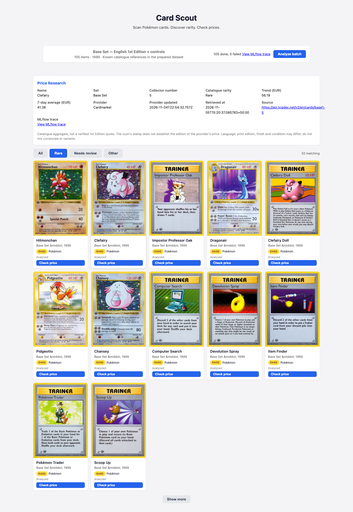
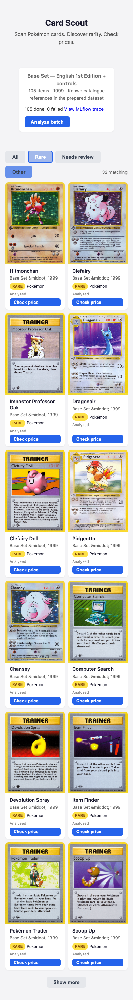
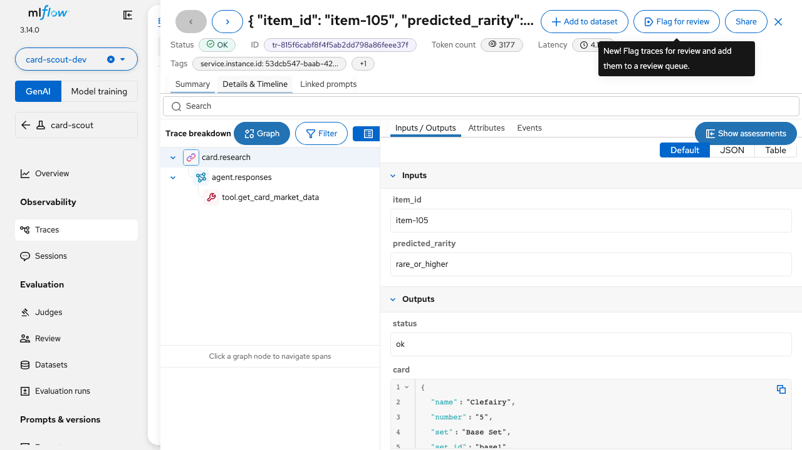
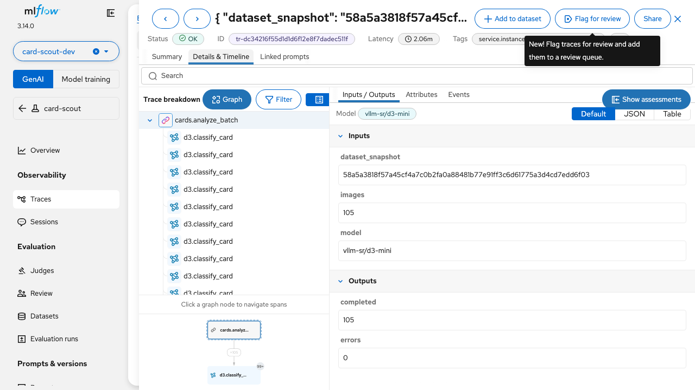
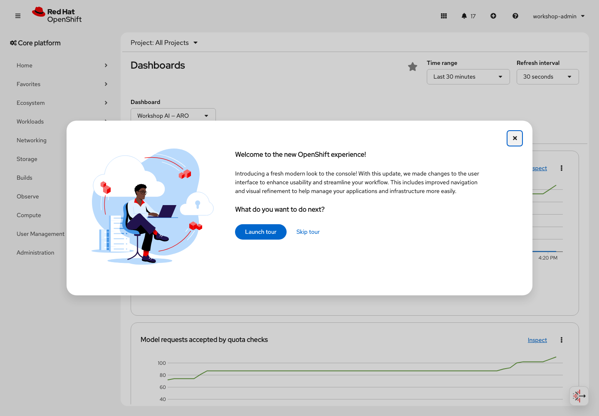

# Fresh-cluster participant validation — 7vxhk

Tested November 5, 2026, starting with three CPU workers and no workshop operators.
Followed Acts 0–3, used the real browser Dev Space and generated Card Scout from
scratch with DeepSeek Pro. Corrections were applied and retested on this lab;
this is not a claim that the original instructions passed unchanged or that a
second entirely pristine installation was performed after the corrections.

- Starting guide: `9d5878687ce4b7cb132824e8524d189c0c570cc7`.
- Starting template: `3e02f53269c91f1a2d9065c7b6ae0d10b58b09bc`.
- OpenShift 4.21.22; OpenShift AI 3.5.2; Dev Spaces 3.31.2.
- One additional D8 CPU worker and one NC8as T4 v3 worker; a single Tesla T4.
- DeepSeek-V4-Pro `2026-04-23`, Foundry GlobalStandard, East US 2.
- Final application: `d9fb602fae825c5e9f07f2d4d571b3dcfed43243`.
- Final pipeline: `build-app-4qvwb`.
- Image: `sha256:a00c10d66a1753bed9df5d6e71922a281abd3f4b8d6c5b6335e8e8cda3d1b5e5`.

[Application](https://card-scout-card-scout-dev.apps.o578n620.eastus.aroapp.io)
and [workshop](https://fjcloud.github.io/aro-ai-app-platform/).
The lab URLs expire with the RHDP environment. Credentials, private Git URLs,
wallets, kubeconfigs and raw model logs are excluded from this record.

## Guide corrections

| Finding | Change and actual validation |
| --- | --- |
| A digest-pinned OpenCode injector prevents fresh workspace creation: Dev Spaces derives invalid component and command names containing `@sha256`. | Use versioned tag `1.18.14-20260826-3ea5bb0`, verified to resolve to the same multiarch digest. A new factory-created workspace then started successfully. |
| The factory can exceed its 20-second GitHub devfile-resolution deadline. | Document the UI retry and keep the repository devfile. Do not fall back to the default devfile. |
| The first workspace launch downloads a 9.5 GB developer image. | Install the documented Kubernetes Image Puller operator with the other operators. Cache only the developer, installed editor and OpenCode images on the four CPU workers while preparing the models. The exact new CLI block passed on the bastion. |
| A real push after restarting Dev Spaces returns HTTP 401, even though an up-to-date dry run succeeded. | Persist the Git helper and `useHttpPath` in `.git/config`, retaining the existing wallet and personal origin. After another real stop/start, a new commit pushed successfully without `gitpop init`. [Template PR 14](https://github.com/fjcloud/go-app-template/pull/14) targets `aro-card-scout`, not the ROSA template branch. |
| `oc get csv -A` contains hundreds of copied OLM entries. | Filter copied CSVs in the operator inspection command. |

The initial named-user login needed the already documented OAuth reconciliation
retry. No controller recycling, facilitator SCC grants, administrator developer
kubeconfig, provider-model substitution or copying completed app source was used.
The operator-managed platform and the generated application have distinct roles;
the application was admitted under `restricted-v2`, with no model Secret or
Kubernetes token mounted. Builds used Linux user namespaces without privileged
containers.

## Workspace startup

| Measurement | Observed |
| --- | --- |
| First workspace creation to Ready, including image downloads and home initialization | 256 seconds |
| Developer image download, 9,546,605,131 bytes | 145.857 seconds |
| Cached developer-image manifest check during restart | 0.803 seconds |
| Two subsequent Open clicks to workspace Ready | 78.489 / 88.805 seconds |
| Final dashboard Stop/Open cycle to a usable browser editor | 75.717 seconds |

The warm runs reuse images and an initialized persistent home, so the difference
does not isolate preloading alone. Caching moves downloads into the platform
preparation phase; first-time home initialization still takes time. Browser tests
used Chromium with `--use-mock-keychain` and retained the normal inactivity timeout.
See [measurements](startup.json).

## Actual workshop acceptance

| Area | Result |
| --- | --- |
| Act 0 | Repository clone, `make onboard`, dynamic resource-group discovery, named account and token login passed. |
| Operators and capacity | All subscriptions, readiness checks, CPU/T4 MachineSets and installed Red Hat pipeline-task adapters passed. [Operator inventory](operators.json). |
| Platform | PostgreSQL PVC, MaaS gateway, Authorino TLS/service CA, DSC/DSCI, Dev Spaces, MLflow and GPU readiness passed through the guide commands. |
| Foundry and MaaS | Real direct and gateway completions; separate workspace/runtime keys; invalid/missing-key rejection, streaming and tool-call protocol checks passed. [Protocol](maas-protocol.json). |
| Developer APIs | All four Lab 2.2 blocks ran in the real scoped workspace: CUDA FP16, Charizard star, Basic Energy absent symbol, measured DeepSeek usage and an actual native Responses MCP call. [Results](model-apis.txt). |
| Generated application | Three real delivery cycles. Final workspace source, pushed commit, Argo revision and image digest matched; exact Step 5 CLI commands also passed. [Delivery](delivery.txt), [CLI](step5-cli.txt). |
| Live browser | 105 analyses, persisted results, whole images, pagination, full-batch filters, saved filter, numeric price evidence, dated sources, trace links and 390 px mobile layout passed. [Results](app-live.json). |
| Large image proxy | Charizard, Pikachu artwork and 2,186,336-byte Black Lotus matched the platform byte for byte. [Hashes](image-integrity.json). An earlier transfer was interrupted while the harness simultaneously forced the Step 5 pod restart; the sequential stable-deployment check passed. |
| Playground | DeepSeek Pro and the public MCP connector completed a real Charizard lookup without a connector token. [Results](playground.json). |
| MLflow | Opened the exact app research trace and its root/model/tool spans, plus the batch trace and D3 spans, in Details & Timeline / Graph. |
| Monitoring | All nine dashboard queries returned series; both scrape targets were up. The actual OpenShift dashboard displayed all panels without “No datapoints”. [Measurements](observability.json). |
| Quota | Temporary one-token subscription produced HTTP 429; its key was revoked and subscription removed. The rejection counter reached 1 after scrape propagation. [Probe](quota.json), [counter](quota-after-scrape.json). |

The code generator needed review. The initial UI lacked retry recovery, accepted
unsafe links, lost the selected-card name on price failures and hid refresh
failures when filtering. A further review caught repeated initial failures, an
unused timeout, external image URLs and attribute injection. DeepSeek implemented
the corrections. This was not one-shot generation success.

Seven independent, explicitly synthetic browser fixtures now pass: repeated
load/retry recovery; zero/null/text and protocol handling; price retry with
selection retained; cached refresh failure/recovery; a 210-second timeout using
simulated browser time; fixed same-origin image paths; and attribute safety.
These fixtures did not enter the running platform dataset. [Results](browser-fixtures.json).

## Model quality

All 105 real image requests completed. Held-out reference comparison found
104/105 correct card-kind decisions and 97/105 exact kind-and-rarity matches.
All 32 rare cards matched; seven Uncommon cards were classified Common and one
Basic Energy card was classified as another card. No catalogue label was used to
replace a model prediction. This measures this curated collection, not arbitrary
phone photos or other editions. [Full comparison](classification.json).

## Reproduce this generated UI's browser checks

The dated scripts below use this implementation's selectors. They require an
already deployed app and analyzed batch, plus the repository's `e2e` npm dependencies.
They write new results to a separate directory; they do not replace the platform
dataset with fixture data.

```sh
export APP_URL=https://your-card-scout-route
export CARD_SCOUT_RESULTS_DIR=/tmp/card-scout-validation
node e2e/results/aro-7vxhk/browser-live.cjs
node e2e/results/aro-7vxhk/browser-fixtures.cjs
```

Local regression checks, Go example tests, terminal browser fixtures and the
Antora build also passed. See [structured validation](validation.json).






