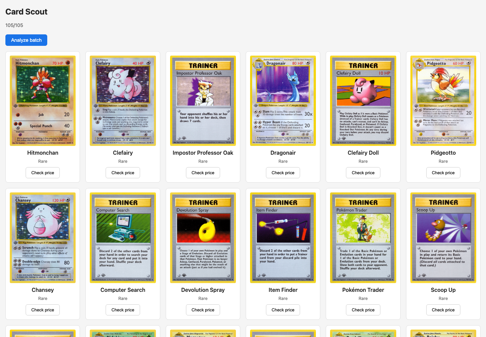
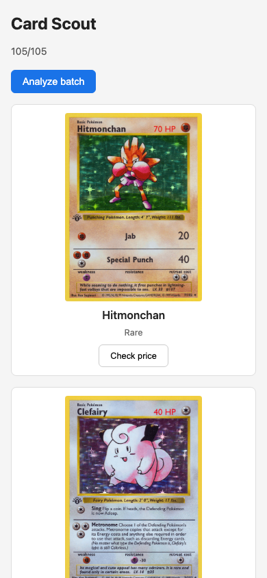

# Minimal Card Scout — single-prompt trial

November 5, 2026, ARO lab 7vxhk. A fresh Dev Spaces workspace cloned template
`9f5f0b871f9ffe9ba28db70daf66342df9d91926` with no application source.
DeepSeek Pro received the [single prompt](prompt.txt) in build mode. No follow-up
code feedback or manual application edits were supplied.

The platform, models and backend were already prepared. Test tooling was checked
before starting the trial. This is an app-generation experiment, not a new
full-cluster provisioning run.

## What changed

- `APP_CONTRACT.md`: 64 lines; display all cards, analyze, check a sourced price.
- `AGENTS.md`: 17 lines; follow the contract, run fixed tests, fix app failures,
  ship and run the live check. Detailed delivery commands are in `DELIVERY.md`.
- No filters, pagination or saved preferences in the minimal app.
- Four provided acceptance tests exercise the actual Go binary, built with the
  race detector, against a local fixture API and a browser. They cover fixed
  routes, complete images over 2 MiB, analysis/reload, mobile layout, price
  evidence and retry recovery. Fixtures never become application data.
- A separate live check compares the deployed app with the real platform dataset
  and performs price research with source/MLflow links.
- A loopback-only browser component supplies the system dependencies missing in
  the developer image. It is test tooling, not part of the delivered Go image.
  The image cache preloads it; idle cache CPU requests are 10m so the workspace
  fits on the existing workers. No worker or SCC grant was added.

## Observed result

| Attempt | Passed acceptance tests |
| --- | --- |
| Initial generated app | 0 / 4 |
| First automatic correction | 2 / 4 |
| Second automatic correction | 3 / 4 |
| Third automatic correction | 4 / 4 |

**One prompt completed generation, automatic correction and real delivery.
The first draft did not pass.** The model read the test failures and changed its
own application. All 28 prepared tracked files, including tests, package manifests
and delivery scaffolding, retained their original hashes. Only `Dockerfile`,
`go.mod`, `main.go` and `index.html` were added.

The existing Argo CD Application initially retained the previous source revision;
the model resolved the deployment mismatch within the same session. Its live
check then passed. There was one successful image build for the generated app.

- App commit: `63bbfd977f18dbcacea7a0d3307930e38002af57`.
- Pipeline: `build-app-ndwh8`.
- Image: `sha256:3e8c8f8f123ddf6887ce1d57bfdb24233647899ce0cdf23f49ac08a0be595ddd`.
- Four local tests passed again in an independent rerun, followed by the live
  check with the real 105-image collection and actual price evidence.
- Independent delivery checks confirmed clean source, matching pushed/Argo
  revisions and image digest, `restricted-v2`, and no mounted application token
  or model Secret.
- Browser checks confirmed all 105 cards, no filter/pagination controls and no
  horizontal overflow at 390 px.

[Structured result](result.json), [model test sequence](model-test-runs.json),
[independent acceptance](acceptance.txt), [delivery checks](delivery.txt).
Credentials, wallets, private Git URLs and raw model logs are excluded.

[Application](https://card-scout-card-scout-dev.apps.o578n620.eastus.aroapp.io)
expires with the lab. Reproduce the generation from the ARO template, not from a
completed app; no generated application implementation is included here.

