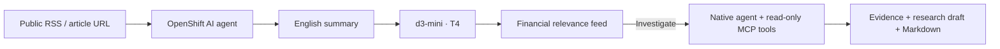

# Signal Desk — ARO experiment

An English hedge-fund news feed: native OpenShift AI agent retrieval and summaries,
local d3-mini financial relevance on one T4, and on-demand agent investigations.

Use an already prepared ARO lab with the native agent, MaaS DeepSeek model,
local d3-mini, OAuth proxy and Git → Tekton → Argo CD application workflow.
The facilitator runs `python3 scripts/prepare-briefing-desk.py`, then copies this
reference and the `feature/briefing-desk` template into the personal app repository.
Retain the technical name `live-transcript` and its exact internal-registry image.

The template adds a persistent `/data` volume and a namespace-internal MCP port.
The public route stays behind OAuth; only the existing native agent can reach
MCP, which also requires an expiring per-job capability. No extra GPU, SCC or
monitoring permission is needed. The MaaS runtime key expires after 24 hours;
rerun preparation and restart the app to renew it.

BBC World, BBC Business and France 24 supply current RSS headlines. The agent
selects up to three and reads their public pages. Inaccessible or unreadable
pages fail explicitly. It never substitutes an invented summary.

Fund mandates are editable. Financial triage yields Material, Monitor, Needs
context or Not relevant. Only fresh positive results unlock Investigate.
Mandate changes invalidate older classifications and research. Reclassify before
investigating again. Confidence is the classifier output, not a calibrated market
probability or a return forecast.

Investigations must successfully read the original source and use at least one
other tool. Tools search the latest 12 items in each RSS feed, retrieve SEC
submission metadata for a documented set of US tickers, or read five ECB daily
FX reference observations. This is bounded research, not exhaustive web search.
Tools provide no execution prices. Reports separate source facts, conditional
financial hypotheses, unknowns and next checks. Evidence IDs must refer to
actual successful tool responses; factual interpretation still requires review.

English summaries, mandates and research notes persist on the workshop PVC.
Download an article, a research note or the financially relevant briefing as
Markdown. No orders or client messages are sent.

Local validation: `go test -race ./...` and `go vet ./...`.
Runtime settings: DATA_DIR, AGENT_URL, AGENT_MODEL, AGENT_KEY_FILE, MCP_URL,
DECISION_URL, DECISION_MODEL, and the existing MLflow OTLP settings.
No credentials belong in Git, browser responses or logs.
